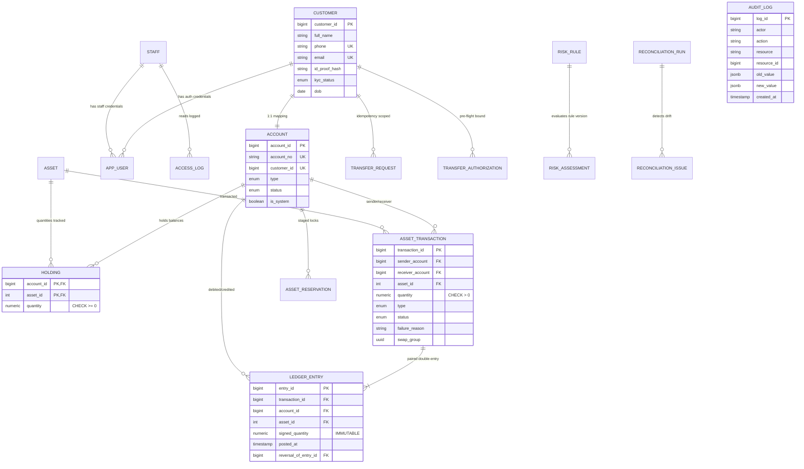

# ByteBank: Digital Asset & Transaction Management Platform

[](https://www.postgresql.org/)
[](https://nextjs.org/)
[](https://www.typescriptlang.org/)
[](#empirical-verification--test-suite)
[](LICENSE)

ByteBank is an end-to-end, production-grade digital asset and transaction management platform engineered as a **Database Management Systems (DBMS) showcase**.

Every button, form, workflow, role, and compliance report operates against real **PostgreSQL** relational tables, immutable double-entry ledger triggers, row-level security (RLS) policies, and ACID stored procedures. **Zero mockup data, zero stubbed handlers, zero fake state.**

> [!NOTE]
> **SIMULATED ASSETS NOTICE:** All cryptocurrency tokens (BTC, ETH, SOL, USDT) and equities (AAPL, TSLA, TCS, INFY) are simulated representations denominated in **Simulated Reserve Units (SRU)**. No fiat currency, credit card, or real-world banking rails are involved.

---

## 1. Quick Credentials Directory

All accounts are pre-seeded in the database (`password123` for all users):

| Role | Name | Email | Account No | Capabilities |
| :--- | :--- | :--- | :--- | :--- |
| **CUSTOMER** | Rahul Sharma | `rahul.sharma@example.com` | `BB-ACC-5002` | View portfolio, transfer assets with risk preview, swap against Market Maker, place reservations, export CSV history |
| **CUSTOMER** | Priya Patel | `priya.patel@example.com` | `BB-ACC-5003` | Verified customer counterparty for transfers and swaps |
| **CUSTOMER** | Aman Gupta | `aman.gupta@example.com` | `BB-ACC-5004` | Unverified KYC / Frozen account (used for compliance rejection tests) |
| **ADMIN** | Rajesh Admin | `rajesh.admin@bytebank.sim` | `BB-ACC-1001` | Review KYC queue, freeze/unfreeze accounts, adjust reference prices, run ledger reconciliation, launch DBMS Lab |
| **AUDITOR** | Sunita Auditor | `sunita.auditor@bytebank.sim`| N/A (Read-Only)| Zero-PII masked transactions view (`v_auditor_transactions`), immutable audit logs, staff access logs, compliance analytics |

---

## 2. DBMS Concepts & Architectural Implementation Matrix

ByteBank was built to demonstrate how fundamental DBMS and transaction-management principles are realized in production software:

| DBMS Concept | Where Implemented | Verification & Proof |
| :--- | :--- | :--- |
| **Relational Normalization (3NF & BCNF)** | All 19 relational entities (`db/migrations/001_initial_schema.sql`) | Zero transitive dependencies; candidate keys determine all non-prime attributes. |
| **Row-Level Locking (Pessimistic Concurrency)** | Stored procedure `transfer_assets()` | Locks holdings in consistent order: `ORDER BY account_id, asset_id FOR UPDATE` preventing deadlocks. |
| **Immutable Double-Entry Ledger** | Table `ledger_entry` + trigger `trg_ledger_immutable()` | Database trigger blocks `UPDATE` and `DELETE` on all ledger rows. $Holding = \sum Ledger$. |
| **Completed Transaction Guard** | Trigger `trg_transaction_completed_immutable()` | Prevents altering quantity, accounts, or status on finalized transactions. |
| **Idempotency & Request Fingerprinting** | Table `transfer_request` | Scoped per customer with SHA-256 parameter hash. Identical retry returns cached result; modified body returns 409 Conflict. |
| **Row-Level Security (RLS)** | `004_security_rls_and_roles.sql` | Policies applied on non-owner roles (`bytebank_customer`, `bytebank_auditor`). |
| **Zero-PII Compliance Masking** | View `v_auditor_transactions` | Regulatory view omitting names, phone numbers, addresses, and masking account numbers. |
| **Automated Ledger Reconciliation** | View `v_reconciliation` + procedure `run_reconciliation()` | Detects balance-to-ledger drift; creates `reconciliation_issue`. Fixed via linked reversal entries. |
| **Two-Phase Asset Reservations** | Procedure `reserve_asset()`, view `v_available_quantity` | Staged checkout reduces available balance without modifying holding totals until consumed. |
| **Autonomous Failure Logging** | `src/lib/db.ts` (`recordAutonomousFailure`) | Persists failed attempts and audit logs outside rolled-back transactions via connection pool. |
| **Purpose-Coded Read Auditing** | Table `access_log` + `/api/admin/customer-lookup` | Enforces mandatory purpose code dropdown (`FRAUD_INVESTIGATION`, etc.) before staff can read customer PII. |

---

## 3. Entity-Relationship Diagram



---

## 4. One-Command Setup & Execution

### Prerequisites:
- PostgreSQL 16+ running locally on port 5432 (or via Docker)
- Node.js 18+ and npm

### Local Development:
```bash
# 1. Install dependencies
npm install

# 2. Configure environment (pre-configured for localhost)
cp .env.example .env.local

# 3. Apply PostgreSQL migrations & seed 125 master customers
npm run migrate
npm run seed

# 4. Verify 15/15 database invariants
npm test

# 5. Start development server
npm run dev
# ByteBank is live at http://localhost:3000
```

### Docker Compose Setup:
```bash
# Launch PostgreSQL 16, pgAdmin 4, and ByteBank Next.js container
docker compose up -d

# pgAdmin is accessible at http://localhost:5050 (admin@bytebank.sim / adminpassword)
```

---

## 5. Signature Features

### A. Transaction Safety Preview (Rule-Based Screening)
Before transferring assets, the user executes a pre-flight assessment against stored procedure `assess_transfer_risk()`. Rules evaluate:
- Unverified KYC status $\rightarrow$ `REJECT`
- Frozen sender or receiver account $\rightarrow$ `REJECT`
- Insufficient available balance (total minus reserved) $\rightarrow$ `REJECT`
- First-time transfer to a new counterparty $\rightarrow$ `REQUIRE_EXTRA_CONFIRMATION`
- High-value per-asset parameter check $\rightarrow$ `REQUIRE_EXTRA_CONFIRMATION`

Upon passing, PostgreSQL generates a bound `transfer_authorization` token with a strict 15-minute expiration timestamp. Any change to recipient, asset, or quantity invalidates the authorization.

### B. Retry-Safe Transfers (Idempotency)
Transfers require an `Idempotency-Key` header. ByteBank creates a SHA-256 fingerprint from the request parameters (`sender_account`, `receiver_account`, `asset_id`, `quantity`).
- **Exact Retry:** Returns the original cached transaction (`200 OK`, `IDEMPOTENT_REPLAY: true`) without re-executing balance debits.
- **Payload Conflict:** Submitting the same key with altered parameters returns **HTTP 409 Conflict** with a fingerprint mismatch explanation.
- **Concurrent In-Flight:** Prevents double submissions while the initial request is in progress.

### C. Atomic Simulated Swap against Market Maker Treasury
ByteBank never conjures balance out of thin air. Buying and selling digital assets executes via `simulated_swap()` as two strictly paired transactions against the system **Market Maker Treasury (`BB-TREASURY`)**:
- **Leg 1 (Sell):** Customer debited for source asset $\rightarrow$ Treasury credited.
- **Leg 2 (Buy):** Treasury debited for target asset $\rightarrow$ Customer credited.
- **Invariant:** 4 immutable ledger entries created simultaneously. If the Treasury has insufficient target balance, the entire swap rolls back under ACID semantics.

### D. Two-Phase Asset Reservations
Available balance is calculated as:
$$\text{Available Quantity} = \text{Holding Quantity} - \sum(\text{Active Reservations})$$
- Placing a reservation (`reserve_asset()`) reduces available balance immediately while keeping the holding table unchanged.
- Finalizing a transaction consumes the reservation atomically.
- Cancelling or expiring releases the lock back to available balance without deleting transaction history.

### E. Privacy-Aware Access Log & Zero-PII Auditor View
- Every staff query against customer PII goes through a controlled API path requiring a **mandatory purpose code** (`KYC_VERIFICATION`, `FRAUD_INVESTIGATION`, `CUSTOMER_SUPPORT_INQUIRY`, `COURT_ORDER_LEGAL`).
- Queries write an immutable row to PostgreSQL `access_log`.
- Regulatory auditors connect under restricted database roles with zero access to the `customer` table. They read exclusively from `v_auditor_transactions`, which strips names, phone numbers, and addresses.

### F. Interactive In-App DBMS Lab
Accessible via the Admin portal (`/admin/lab`), this interactive sandbox allows evaluators and professors to trigger and inspect DBMS edge cases live:
1. **Concurrency Race:** Two parallel database connections attempt to transfer 0.8 BTC from a 1.0 BTC balance. Demonstrates that row-level locks serialize execution: Thread 1 commits, Thread 2 cleanly fails with `Insufficient balance`, and final balance is mathematically exact (0.2 BTC).
2. **Idempotency Replay & Conflict:** Test identical retries vs. payload hash mismatches.
3. **Crash Rollback & Autonomous Failure:** Triggers an intentional mid-transaction failure. Shows that holding debits roll back cleanly, while the failed-attempt transaction and audit log **survive via autonomous connection logging**.
4. **Reconciliation Drift & Remediation:** Deliberately injects balance drift, detects it via `run_reconciliation()`, and fixes it using a compensating reversal ledger entry.

---

## 6. Empirical Verification & Test Suite

Run the full invariant and concurrency verification test suite:
```bash
# Full Invariants Test Suite (15 Tests)
npm test

# Dedicated ACID Concurrency Race Condition Test
npm run test:concurrency
```

Output:
```text
===============================================================
       BYTEBANK DATABASE INVARIANTS & INTEGRITY TEST SUITE     
===============================================================

--- PostgreSQL Test Invariant Results ---
  ✓ PASS T01: Normal atomic transfer with paired zero-sum ledger
  ✓ PASS T02: Overspend correctly rejected with Insufficient balance
  ✓ PASS T03: CHECK constraint prevents negative balance
  ✓ PASS T04: UNIQUE constraints on phone and email enforced
  ✓ PASS T05: Strict 1:1 customer account relationship enforced
  ✓ PASS T06: KYC verification and account unfreezing strictly gated
  ✓ PASS T07: Idempotency key uniqueness scoped per customer
  ✓ PASS T08: Ledger is append-only (UPDATE and DELETE prohibited)
  ✓ PASS T09: Completed transactions cannot be modified
  ✓ PASS T10: Reconciliation detects drift (issues: 2 -> 3) without altering ledger
  ✓ PASS T11: Auditor transaction view contains zero customer PII
  ✓ PASS T12: Rule-based screening generated outcome=ALLOW auth_token=...
  ✓ PASS T13: Two-phase reservation locks available quantity atomically
  ✓ [T14] trg_ledger_immutable: PASS (Trigger correctly blocked UPDATE on ledger_entry)
  ✓ [T15] trg_ledger_immutable_delete: PASS (Trigger correctly blocked DELETE on ledger_entry)

===============================================================
SUMMARY: 15/15 Invariant Tests Passed, 0 Failed.
===============================================================
ALL INVARIANTS SATISFIED! High integrity proof verified.
```

